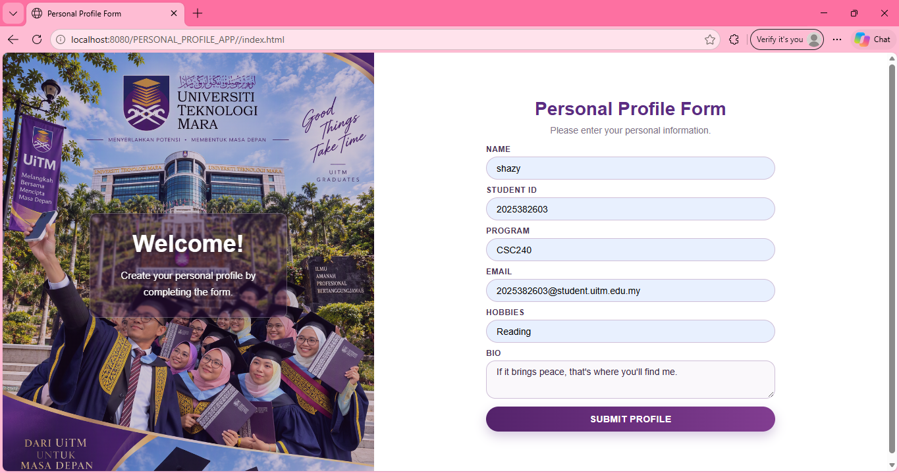
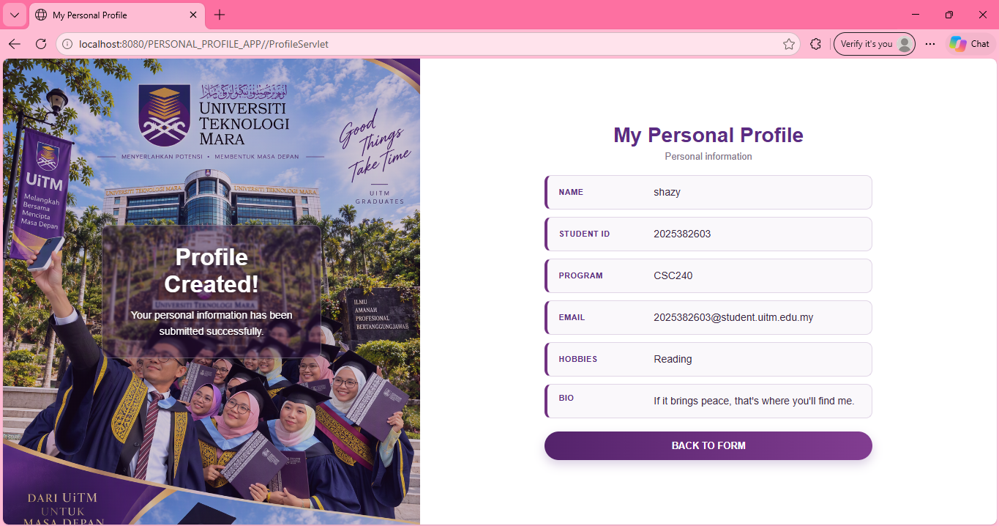

NAME: NUR SHAZWANA BINTI SAI'MAN
STUDENT ID: 2025382603

### CSC584 Individual Assignment 1

#### Personal Profile Web Application

This is a Java web application that collects personal information through an HTML form. The information is processed by a Java Servlet and displayed on JSP profile page.

#### Features

* Personal profile HTML form
* HTTP POST submission
* Java Servlet processing
* JSP profile display
* Responsive layout
* UiTM inspired design
* Background image on the form and result page

#### Information Collected

* Name
* StudentID
* Program
* Email
* Hobbies
* Bio

#### Technologies Used

* HTML 5
* CSS3
* Java Servlet
* JSP
* NetBeans

#### Application Flow

1. The user enters personal information in index.html.
2. The form sends the information to ProfileServlet using HTTP POST.
3. ProfileServlet processes and forwards the values.
4. profile.jsp displays the personal profile.

#### How to Run

1. Open the project in NetBeans.
2. Configure the Tomcat server.
3. Clean and build the project.
4. Run the project.
5. Complete the form.
6. Click Submit Profile.

#### Screenshots

1. Personal Profile Form

2. Submitted Personal Profile

